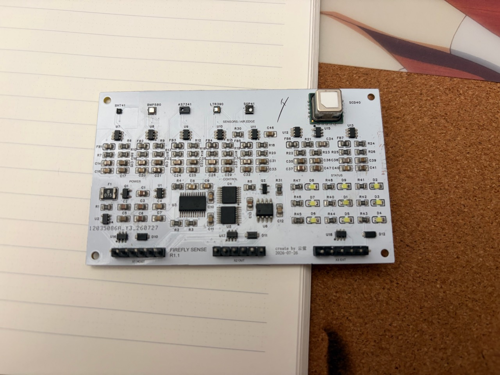
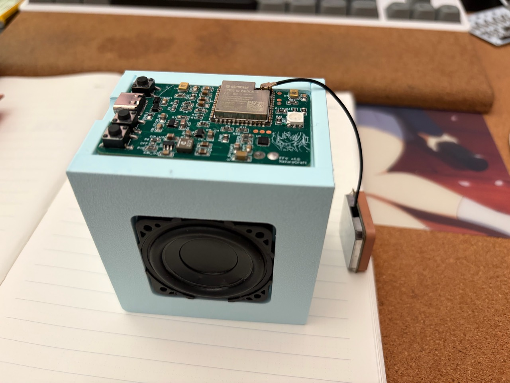

# Existime

把自己做的硬件，慢慢整理在这里。

这里会放原理图、PCB、固件和制作资料。实物展示和制作记录，也会放到[云萤 · FlitFancy](https://flitfancy.com/resources.html)。

目前整理了 FFS 环境感知板、FFA 双麦语音交互板、map 地图灯、Flitime 电子沙漏主板、FFT 主控与显示终端、SICK 电机换向板和 OLED 小屏幕接口板，工程和软件会随着使用继续完善。

## 项目与资料

硬件项目放在 [`projects/`](projects/)，每个项目一个目录。原理图、PCB、BOM、固件、外壳模型和使用说明随项目整理，具体版本、验证进度和许可证在各项目中说明。

FFS、FFA的首批资料以 [正式版 v0.1.0](https://github.com/flitfancy/Existime/releases/tag/v0.1.0) 提供下载；这两个项目的预编译固件后续另行发布。map的四套硬件包、BOM和固件见 [map正式版 v0.2.1](https://github.com/flitfancy/Existime/releases/tag/v0.2.1)。

FFS、FFA、map 均已由作者完成实物与功能验证，并于 2026-10-22 确认转为正式发布。

## 开源项目

### OLED · 小屏幕接口板

30针OLED历史接口板，包含完整原生设计、设计BOM和40×37mm原制造资料；实装与返修差异单独保留。

[项目资料](projects/OLED/README.md) · [历史归档 v0.6.0](https://github.com/flitfancy/Existime/releases/tag/v0.6.0)

### SICK · 电机自动换向板

插件/混装版、R3贴片版、Lite（DRV8876）三版集中保留在同一个SICK项目中，原始工程、版本BOM和制造文件分别归档，方便查阅与改版。

[版本对照与资料](projects/SICK/README.md) · [历史归档 v0.6.0](https://github.com/flitfancy/Existime/releases/tag/v0.6.0)

### FFT · 主控与显示终端

ESP32-S3主控与显示板，90×40mm、R2mm圆角，带压力输入与FFS供电/通信接口。当前作为硬件预发布版公开，提供压力台架测试源码；完整显示/时钟/天气主程序和实物验证待完善。

[项目资料与当前状态](projects/FFT/README.md) · [硬件预发布 v0.4.0](https://github.com/flitfancy/Existime/releases/tag/v0.4.0)

### Flitime · 电子沙漏主板

ESP32-S3电子沙漏主板，43×77mm、R2mm圆角。当前作为硬件预发布版公开，工程、BOM、Gerber和装配坐标已具备，固件、配套软件与实物照片暂空。

[项目资料与当前状态](projects/Flitime/README.md) · [硬件预发布 v0.3.0](https://github.com/flitfancy/Existime/releases/tag/v0.3.0)

### FFS · FIREFLY-SENSE 环境感知板

六通道环境感知板，配合外部主控采集、显示和传输身边的环境数据。

[项目介绍与照片](projects/FFS/README.md) · [完整资料目录](projects/FFS/README.txt)

### FFA · FIREFLY VOICE 双麦语音交互板

ESP32-S3 双麦采音与播放终端，配合电脑端服务完成语音识别和交互。

[项目介绍与照片](projects/FFA/README.md) · [完整资料目录](projects/FFA/README.txt)

### map · 省份记录与指南针地图灯

34颗省份灯记录、八方向指南针和电量显示。提供charge板载充电版与battery外部电池版，每版都有完整丝印和无背面丝印两种选择，以及全亮测试/正常使用两类固件。charge与battery均已由作者确认实板功能验证成功。

[项目介绍与下载](projects/map/README.md) · [工作逻辑](projects/map/04-装配资料/使用说明/operation-logic.md)

FFS、FFA首批资料于2026-10-20整理；map资料于2026-10-22更新。各项目的 `MANIFEST.json` 记录文件校验和已有检查范围，版本与验证进度以项目说明为准。

## 授权

FFS、FFA、Flitime、FFT、SICK、OLED 的原创硬件设计采用 **CERN-OHL-S-2.0**，具体范围和第三方例外见各项目的 `HARDWARE-NOTICE.txt`。

map 的原创硬件设计采用 **CERN-OHL-P-2.0**，软件与原创说明采用 **MIT**；范围及第三方材料说明见[map许可范围](projects/map/LICENSING.md)。

原创固件与配套软件采用 **MIT License**；第三方保留原许可证和声明。软件条款见 [MIT 许可证](LICENSE-SOFTWARE.txt)，完整范围见 [授权说明](LICENSING.txt)。
