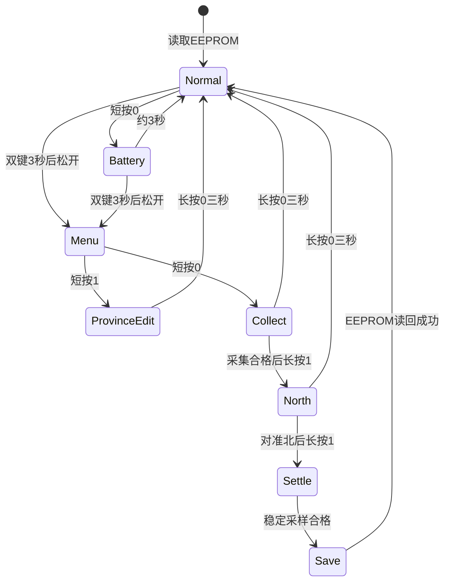

# map 工作逻辑

map 有两种用途不同的固件：全亮测试版用于焊接检查；正常版用于省份记录、指南针和电量显示。硬件 v1/v2 各有下载目录，丝印选择不影响固件。

## 全亮测试版

上电后，34颗省份灯、8颗方向灯和中心灯共43颗持续点亮。程序将五颗 TCA9534（0x20～0x24）的输出锁存器与方向寄存器置0，并将PA6、PA7、PA8拉低；循环检查应答和寄存器读回，失败后继续重试。

本程序不处理按键、指南针、充电通知或电量，不访问或改写外部 EEPROM。它检查亮灯与相关供电/I²C路径，不能代替传感器、电池保护或充电测试。测试后重新刷正常版，之前保存在EEPROM的省份和校准记录仍可恢复。

两个硬件版本的LED接线已经逐项核对一致，因此全亮程序共用源码，两个下载目录中的二进制相同。v1曾实物确认43灯全亮；v2仍待打样测试。

## 正常版：开机与按键

开机初始化灯、传感器和ADC，读取EEPROM中最近一条CRC及提交标志均有效的记录，恢复34个省份状态与校准参数。空白EEPROM的省份默认全灭，未校准时不输出指南针方向。

**按键0=SW2/PA1，按键1=SW1/PA0。**

| 所在状态 | 操作 | 结果 |
| --- | --- | --- |
| 正常或电量页 | 短按0 | 从D42开始逐颗显示电量/电压档，约3秒返回指南针 |
| 正常或电量页 | 双键同时按住满3秒后松开 | 进入编辑菜单，中心灯慢闪 |
| 编辑菜单 | 短按0 | 进入磁力校准采集 |
| 编辑菜单 | 短按1 | 进入省份编辑 |
| 省份编辑 | 短按0/短按1 | 选上一个/下一个省份，34项首尾循环 |
| 省份编辑 | 按住1满1秒 | 点亮选中省份并请求保存 |
| 省份编辑 | 按住0满1秒，在3秒前松开 | 熄灭选中省份并请求保存 |
| 菜单、编辑、采集、对北 | 单独按住0满3秒 | 返回正常；未完成的新校准不覆盖旧值 |
| 校准正在保存 | 等待 | 写入并读回成功后自动返回正常 |

省份按实际PCB的X坐标排序，不按行政区名称排序；顺序见各固件目录的`province-order.csv`。选中省份的闪烁光标不改变保存状态。按键消抖30ms，组合键及长按松手不会额外触发短按。

## 正常版：校准、方向和保存

采集时缓慢旋转、翻转板子，使前后、左右、上下六个面分别朝上。至少20秒、300个合格样本，六姿态与三轴跨度合格后，八方向灯全亮。此时长按1满1秒并松开，进入对北。

对北时D35闪烁。元件面朝上、基本平放，上沿朝向用户选定的北向；长按1满1秒并松开，保持稳定约2秒，取得40个稳定样本。保存并逐字节读回EEPROM成功后，直接返回正常页，中心灯常亮，无需再按0。超时或姿态不合格回到对北等待；保存失败中心快闪并重试。

D35～D42依次表示北、东北、东、东南、南、西南、西、西北，即地图上沿的朝向。当前交付源码的显示窗口为各方向中心 **±3°，包含边界**；连续3个新样本进入同一窗口才亮，离开立即灭。这里描述的是当前实际源码参数，不是绝对精度承诺。未校准、倾斜过大、磁场异常、剧烈运动或数据过期时，方向环不输出方向。

省份与校准保存在外部EEPROM的两个轮换槽中，含序号、CRC和最后提交标志。掉电恢复最近一条完整记录；普通编辑会异步保存，校准必须等保存读回完成才结束。v2保持同一存储格式。

## 正常版：电量与两个硬件版本的差别

短按0后从D42/西北开始，每100ms增加一颗，向D35/北填充。约3秒后自动回指南针；省份设置不变。电量页面暂缓罗盘采样，返回时取新样本。

| 行为 | v1板载充电版 | v2外部电池版首版 |
| --- | --- | --- |
| 电池策略 | 单节4.2V锂电的通用近似曲线 | 默认两节串联碱性AA/AAA；1.8～3.2V线性电压档位 |
| 0档 | 无充电时D42慢闪，充电时D42呼吸 | D42慢闪 |
| 中心灯 | 正常/电量页充电时约3.2秒慢呼吸，否则常亮 | 正常/电量页常亮 |
| 电量环充电显示 | 已有档常亮、下一颗呼吸；8档时最后一颗呼吸 | 当前档全部常亮 |
| 充电完成 | 先见充电，USB有效且CHG高满1秒后，中心和八方向灯常亮3秒 | 没有充电检测、呼吸或完成提示 |
| 状态输入 | 使用PGOOD_N、CHG_N | 忽略原状态引脚，不从电压推测充电 |

v1充电通知每次USB连接只提示一次，拔USB不误报；编辑/校准优先，通知会延后。充电状态不等于已测到充电电流。完整v1规则和锂电曲线见[v1使用说明](user-guide-v1.md)。

v2的0～100内部索引仅用于沿用八档渲染，不代表实际剩余容量百分比。默认1.8V及以下为0档，3.2V及以上为8档；3.2～5V试验输入会饱和显示8档，不表示充电完成。ADC错误、输入异常或样本过期时八灯一起闪。1.8V不会被旧固件的2.3V有效性门限排除，5V也不会被旧锂电的4.35V上限误报。

电池类型通过`06-固件源码/firmware/v2/battery_profile.h`中的编译参数配置，不自动识别，也不增加按键菜单。更换化学体系时应调整后重编译；本首版没有实测碱性容量曲线。低电显示不负责断开电池。

## 当前验证范围

v1正常版重编译与已验收v5镜像逐字节一致。全亮版重编译与此前v1实测镜像一致。v2正常版通过主机回归、Flash/RAM和镜像向量检查，尚未上v2实板；两种丝印共用相应硬件的同一固件。

v2打样后需验证低压带载启动、43灯全亮、电量档位、关机输入电流、3.3V纹波，以及不同亮灯负载下的指南针变化。测试顺序和文件选择见[v2打样说明](user-guide-v2.md)。
