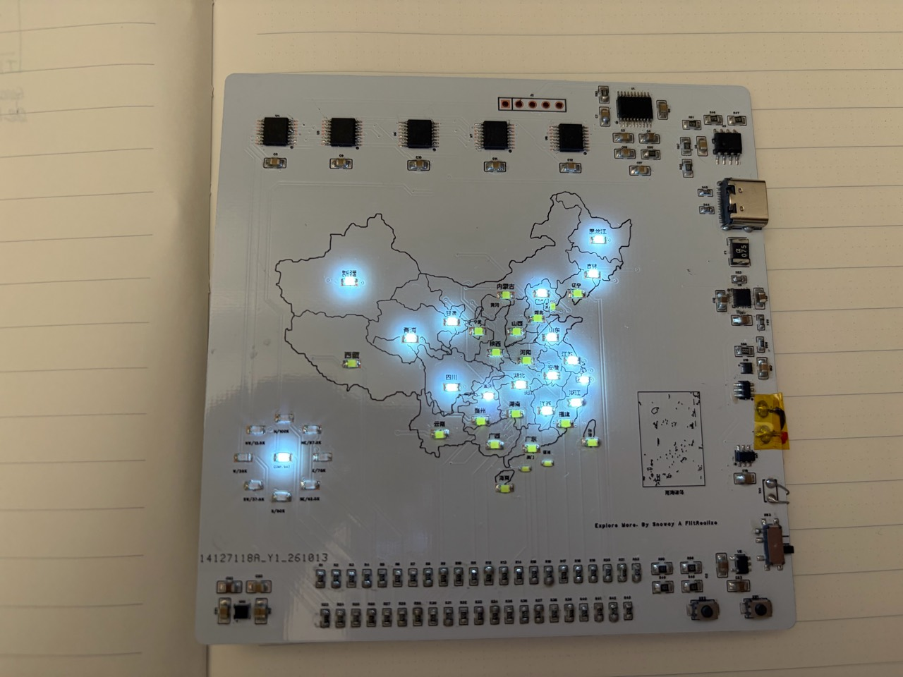

# map · 省份记录与指南针地图灯

34颗省份灯记录、八方向指南针和电量显示。提供charge板载充电版与battery外部电池版，每版各有完整丝印和无背面丝印两种选择，正面丝印均保留。

charge正常固件为已经实物验收的应用v5；battery正常固件为应用v6，默认两节串联碱性AA/AAA电池；作者已确认实板功能验证成功。两版各提供全亮测试与正常使用固件。



图中为charge充电版实物；未亮灯的板子全貌见[实物照片](08-实物照片/README.txt)。

系列命名：`charge` 对应原 v1 充电版，`battery` 对应原 v2 电池版；这是名称调整，应用固件版本及既有硬件设计保持。

## Release 下载

[map 正式发布 v0.2.1](https://github.com/flitfancy/Existime/releases/tag/v0.2.1) 提供四个硬件版本包、完整资料包、固件包、Excel物料表及SHA-256校验文件。每个版本包附匹配的正常/全亮固件；[下载选择与包内说明](04-装配资料/使用说明/release-downloads.md)列出各文件用途。作者于2026-10-22确认map验证成功，现已转为正式发布。

## battery 硬件更新 · 2026-10-22

本次更新对应 v0.2.1：顶部 J2 改为五个无孔表贴 SWD 烧录焊盘，移除旧排针的 3D 显示；重新整理功率出口和地回流，完成顶底 GND 铺铜并补 8 个地孔。现有 6 处附加顶层禁铜区保留。完整丝印、无背面丝印工程及制造文件均对应本次状态。

BOM 经新旧工程和新导出逐项比较，仍为 22 组、132 件，Excel 和 CSV 保持原文件。charge 硬件与四个固件 BIN 保持原内容。两份 battery 工程已重新原生导入，DRC 均为 0；测试范围见[更新核对](05-核对记录/battery-hardware-update.json)。作者后续实测确认见[正式发布记录](05-核对记录/release-confirmation.json)。

## 项目资料

目录与 Existime 的 FFS、FFA 项目一致；charge/battery 和丝印选择放在对应资料目录的下一级。

| 目录 | 内容 |
| --- | --- |
| [01-完整工程](01-完整工程/) | 四份嘉立创EDA原生工程、八页原理图及PCB文档源码、网表和预览 |
| [02-BOM](02-BOM/) | charge/battery合并Excel、参数CSV与原生BOM |
| [03-PCB制造](03-PCB制造/) | 四套Gerber ZIP及逐文件解包、charge历史制造归档 |
| [04-装配资料](04-装配资料/) | 毫米坐标、LED极性图、接线与完整使用说明 |
| [05-核对记录](05-核对记录/) | 原生工程、丝印差异、物料坐标、固件与资料完整性核对 |
| [06-固件源码](06-固件源码/README.txt) | charge/battery正常版、共用全亮测试源码、构建烧录脚本及四个下载镜像 |
| [07-配套软件](07-配套软件/README.txt) | 配套工具范围说明；本板不依赖电脑端常驻服务 |
| [08-实物照片](08-实物照片/) | 用户提供的charge充电版亮灯图和板子全貌 |

## 选择硬件

| 电源版本 | 丝印选择 | 完整可编辑工程 | 制造文件 |
| --- | --- | --- | --- |
| charge 板载充电/锂电保护 | 完整丝印 | [原生工程](01-完整工程/charge/full-silkscreen/map-charge-full-silkscreen.epro2) | [Gerber ZIP](03-PCB制造/charge/full-silkscreen/map-charge-full-silkscreen-gerber.zip) |
| charge 板载充电/锂电保护 | 无背面丝印 | [原生工程](01-完整工程/charge/no-back-silkscreen/map-charge-no-back-silkscreen.epro2) | [Gerber ZIP](03-PCB制造/charge/no-back-silkscreen/map-charge-no-back-silkscreen-gerber.zip) |
| battery 外部电池、1.8–5V设计输入 | 完整丝印 | [原生工程](01-完整工程/battery/full-silkscreen/map-battery-full-silkscreen.epro2) | [Gerber ZIP](03-PCB制造/battery/full-silkscreen/map-battery-full-silkscreen-gerber.zip) |
| battery 外部电池、1.8–5V设计输入 | 无背面丝印 | [原生工程](01-完整工程/battery/no-back-silkscreen/map-battery-no-back-silkscreen.epro2) | [Gerber ZIP](03-PCB制造/battery/no-back-silkscreen/map-battery-no-back-silkscreen-gerber.zip) |

在嘉立创EDA专业版导入对应`.epro2`，包内含原理图、PCB和项目器件库。两种丝印的器件、铜线、铺铜、阻焊、钻孔和电气连接相同；无背面版只去掉背面丝印，正面地图、文字及器件标识保留。同一硬件版本使用同一份BOM与固件。

完整丝印Gerber由EDA原生导出；无背面Gerber以同一完整导出为基线仅移除背面丝印GBO文件，其余14个成员逐字节一致。对应无背面可编辑工程也已经通过原生API移除背面图像并独立保存。

BOM及电源说明：[参数物料表Excel](02-BOM/map-BOM.xlsx)、[物料表说明](02-BOM/BOM说明.md)、[charge硬件](01-完整工程/charge/README.md)、[battery硬件](01-完整工程/battery/README.md)。LED、R/C/L等通用件按参数选料，芯片及机械件保留型号；两版各有一张表，两种丝印共用。两版当前EDA DRC均为0，未做板厂DFM或新一轮装配试产；无背面变体只做工程与文件核对，未重新制作实物。

## 选择固件

| 硬件 | 全亮测试 | 正常使用 | 验证范围 |
| --- | --- | --- | --- |
| charge充电版 | [all-led-on.bin](06-固件源码/releases/charge/all-led-on.bin) | [map-app.bin](06-固件源码/releases/charge/map-app.bin) | 两者重编译均与原charge实测镜像一致 |
| battery电池版 | [all-led-on.bin](06-固件源码/releases/battery/all-led-on.bin) | [map-app.bin](06-固件源码/releases/battery/map-app.bin) | 接线与主机测试通过，待battery实板测试 |

全亮版只让43颗灯持续点亮，不处理按键、指南针、电量或充电，不访问外部EEPROM。正常版支持省份记录、六姿态校准、对北、八方向与电量显示。两个全亮文件因LED接线一致而二进制相同；两版正常固件必须按硬件选择。

按键、校准、保存及指示灯时序见[工作逻辑](04-装配资料/使用说明/operation-logic.md)；[charge详细说明](04-装配资料/使用说明/user-guide-charge.md)、[battery打样说明](04-装配资料/使用说明/user-guide-battery.md)、[固件校验清单](06-固件源码/releases/MANIFEST.json)。当前实际源码的方向显示窗口为±3°。

battery不检测充电状态，正常页中心常亮；八档是默认1.8～3.2V的粗略电压指示，不能当作实测剩余容量百分比。电池类型参数在`06-固件源码/firmware/battery/battery_profile.h`中编译配置，不自动识别化学体系。

## 构建与烧录

Python 3.10或更新版本，固定编译器依赖为`ziglang==0.13.0`，不打包本机工具链。

```sh
cd 06-固件源码
python -m pip install -r requirements-build.txt
python scripts/build_firmware.py all
```

该命令运行两版主机回归并构建四个下载文件。也可只构建battery正常版：

```sh
python scripts/build_firmware.py all --hardware battery --mode normal
```

烧录地址均为`0x08000000`，需要支持STM32C0的OpenOCD及CMSIS-DAP下载器。明确选择硬件与模式，并填写自己的探针序列号：

```sh
python scripts/flash_firmware.py --hardware battery --mode all-on --serial YOUR_PROBE_SERIAL
python scripts/flash_firmware.py --hardware battery --mode normal --serial YOUR_PROBE_SERIAL
```

可用`--openocd`指定程序，`--scripts`指定OpenOCD脚本目录。脚本核对镜像哈希、STM32C011身份和16KiB Flash，然后写入、读回比较并运行。它只擦写MCU程序区，不清除外部EEPROM。旧`build.py`/`flash.py`保留为charge正常版入口。

## 验证与许可

本次整理中，charge正常版通过218381项主机断言，battery正常版通过220951项。四份工程已逐份重新原生导入，DRC均为0，器件及引脚网络与基线一致。全部镜像检查了Flash范围和启动向量；正常版还检查RAM与栈余量。[整理核对记录](05-核对记录/packaging-check.json)和[文件清单](MANIFEST.json)给出对应文件及哈希；[整体复查](05-核对记录/final-review.json)记录目录、重新导入和构建结果。

battery仍需样机验证1.8V带载启动、3.3V纹波、关机输入电流及不同亮灯负载下的指南针干扰。charge既有物理验证不扩展为battery或无背面丝印变体的实物验收。

软件、脚本和原创说明采用[MIT](LICENSE-SOFTWARE.txt)；原创电路、PCB、BOM、制造文件及硬件接线数据采用[CERN-OHL-P-2.0](LICENSE-HARDWARE.txt)。第三方保留原权利信息，范围见[许可说明](LICENSING.md)。
